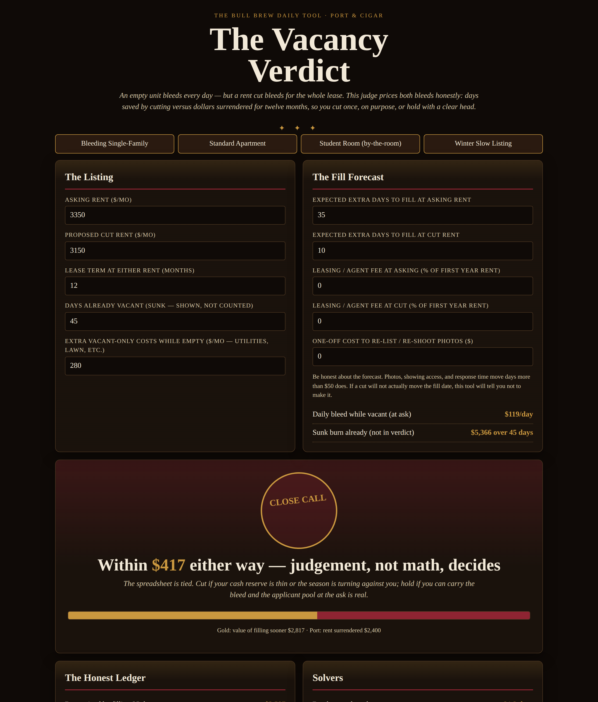

# The Vacancy Verdict

**Live:** https://thebullbrew.github.io/vacancy-verdict/
**Repo:** https://github.com/thebullbrew/vacancy-verdict

## What it does
A rent-cut judge for landlords with a vacant unit. Enter the asking rent, a proposed cut rent, how long the unit has sat, your honest forecast of extra days to fill at each price, vacant-only costs, and any leasing fees — it returns CUT IT / HOLD THE LINE / CLOSE CALL seals, the net advantage of cutting over the full lease, the daily bleed, the sunk burn already spent (shown separately, never counted in the verdict), break-even days-saved and deepest-payable-cut solvers, and days-saved and cut-size sensitivity tables. Four presets, saveable cases, copy summary. Works offline as a PWA.

## The method
A vacancy costs rent plus vacant-only costs every day it sits — but a cut costs the cut amount multiplied by every month of the lease. The tool compares them on one horizon: value of filling sooner (days saved × cut rent + avoided vacant costs) minus rent surrendered over the term, fee differences, and re-list cost. Days already vacant are sunk and deliberately excluded from the decision — only future days can be bought back. If your own forecast says a cut buys zero days, the verdict says so plainly: fix photos and showing access before donating rent.

## How to run
Open `docs/index.html` in any browser, or visit the live link above. No build step, no backend, no accounts.
